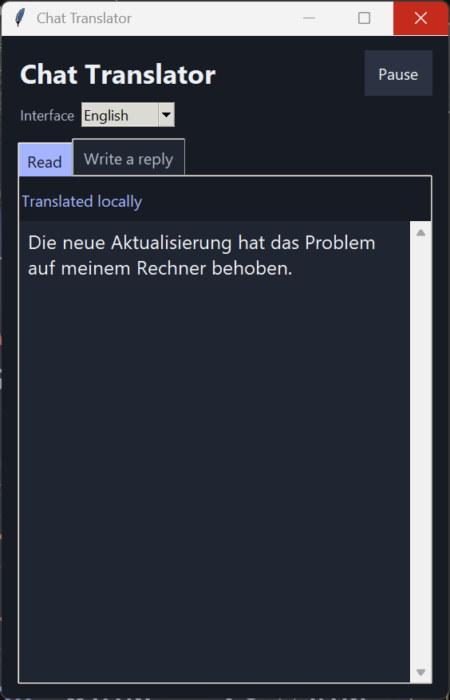
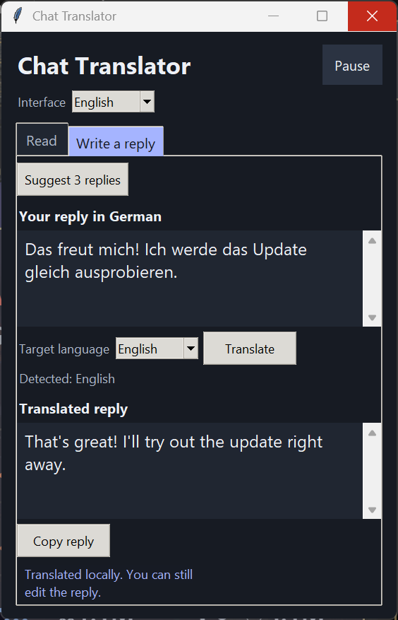
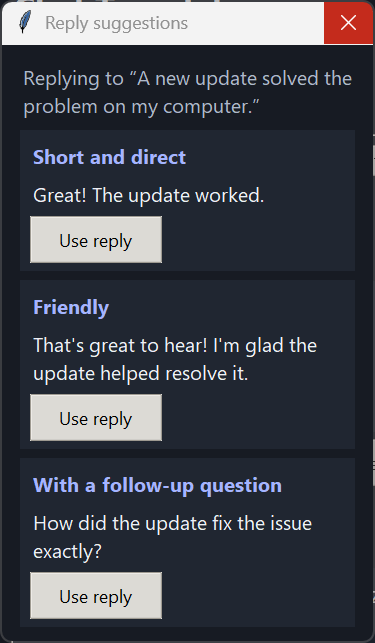

# Chat Translator for Windows

[**Download the Windows EXE**](https://github.com/Doom666DE/chat-uebersetzer/releases/latest/download/Chat-Uebersetzer-win-x64.exe) · [Latest release](https://github.com/Doom666DE/chat-uebersetzer/releases/latest) · [Deutsch](README.md)

Chat Translator works alongside Discord Desktop and WhatsApp Desktop. Choose German, English, Polish, or Turkish separately for incoming translations, reply suggestions, and outgoing replies. Ollama runs the language model on your PC.

Choose **English** from the **Interface** menu at the top of the window. On a German interface, the menu is called **Oberfläche**. **Reading language** and **Suggestion language** follow the interface by default, so both use English when the interface is in English. The app remembers your choices.

| Read a message | Translate a reply | Pick a suggestion |
| --- | --- | --- |
|  |  |  |

## Set up Ollama

The EXE is built for **Windows x64** and includes Python. Discord and WhatsApp were tested on Windows 11. The model download is about **2.5 GB**, with additional disk space needed for Ollama. [Ollama for Windows](https://docs.ollama.com/windows) · [Model page](https://ollama.com/library/qwen3:4b-instruct)

1. Download **OllamaSetup.exe** from the [official Windows download page](https://ollama.com/download/windows), run it, and open **Ollama** from the Start menu. Ollama runs in the background.
2. Open a new **PowerShell** window. Run each command separately and wait for the model download to finish.

   ```powershell
   ollama --version
   ollama pull qwen3:4b-instruct
   ```

3. Check that Ollama is running and the model is available.

   ```powershell
   ollama list
   Invoke-RestMethod http://127.0.0.1:11434/api/version
   ```

   The model list should include `qwen3:4b-instruct` with ID **0edcdef34593**. The second command prints the version of the local Ollama service.

4. Download and launch [**Chat-Uebersetzer-win-x64.exe**](https://github.com/Doom666DE/chat-uebersetzer/releases/latest/download/Chat-Uebersetzer-win-x64.exe). Keep Ollama running while using the translator. The first translation can take longer while the model loads.

The EXE is unsigned. Windows SmartScreen may show a warning for an unrecognized app. To check the download, compare the hash from the command below with [SHA256SUMS.txt](https://github.com/Doom666DE/chat-uebersetzer/releases/latest/download/SHA256SUMS.txt). [Microsoft SmartScreen documentation](https://learn.microsoft.com/windows/apps/package-and-deploy/smartscreen-reputation)

```powershell
Get-FileHash -Algorithm SHA256 .\Chat-Uebersetzer-win-x64.exe
```

## Use the app

1. **Read a message.** Choose a **Reading language** in **Read**, then select message text in Discord Desktop or WhatsApp Desktop. You can also double-click a word to translate the full message when the app can identify it.
2. **Write a reply.** Open **Write a reply** and type your draft. If the selected message is recognized as German, English, Polish, or Turkish, the app selects that **Target language** for the outgoing reply. You can change it. To translate an English draft into German, select **German**.
3. **Use a suggestion.** Choose a **Suggestion language** and click **Suggest 3 replies** once the selected message has been translated. Click **Use reply** to put a suggestion in the draft field.
4. **Translate and copy.** Click **Translate**, review or edit the result, then click **Copy reply**. Paste it into the chat using **Ctrl + V** and send it there.

**Pause** pauses automatic selection capture. **Resume** turns it back on. Translations and suggestions can contain errors, so review the draft before sending.

## Updates

Starting with v0.5.0, the app checks for stable GitHub releases at startup and every six hours while open. Click **Check for updates** to check manually. When an update is available, **Install** downloads the Windows EXE, checks its SHA-256 hash against GitHub's release metadata, and restarts the app. You need write access to the folder containing the EXE.

The app asks before restarting if a reply is open. Your language settings are kept. Update checks and downloads connect to GitHub without sending chat messages or drafts.

Starting with v0.5.4, select **What's new** when an update is available to read its GitHub release notes in the app. Starting with v0.5.6, select **Open GitHub release** in the preview to view the full release page in your default browser.

## Troubleshooting

| Problem | What to do |
| --- | --- |
| PowerShell cannot find `ollama` | Open a new PowerShell window after installing Ollama. |
| Ollama does not respond | Start Ollama from the Start menu and run the local version check above again. |
| The app cannot find the model | Run `ollama pull qwen3:4b-instruct` and wait for it to finish. Check the result with `ollama list`. |
| The model ID differs | This release checks for the tested model version **0edcdef34593**. If the ID on the [model page](https://ollama.com/library/qwen3:4b-instruct) has changed, the app needs an update for that model version. |
| Windows reports a missing `VCRUNTIME140.dll` or `MSVCP140.dll` | Install the [Microsoft Visual C++ Redistributable for x64](https://learn.microsoft.com/cpp/windows/latest-supported-vc-redist) and try again. |
| Selecting text has no effect | Click **Resume** if it is visible, then select plain message text in the desktop app. App updates can change how Discord and WhatsApp expose message text. |

The translator reads selected text through Windows UI Automation and passes it to the local Ollama service at `127.0.0.1:11434`. The translator keeps its working text in memory. Copying a reply puts it in the Windows clipboard. For build instructions and license information, see the [project README](README.md#aus-dem-quellcode-starten-oder-bauen).
