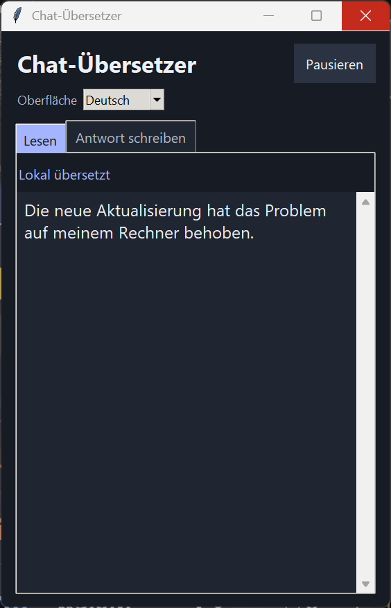
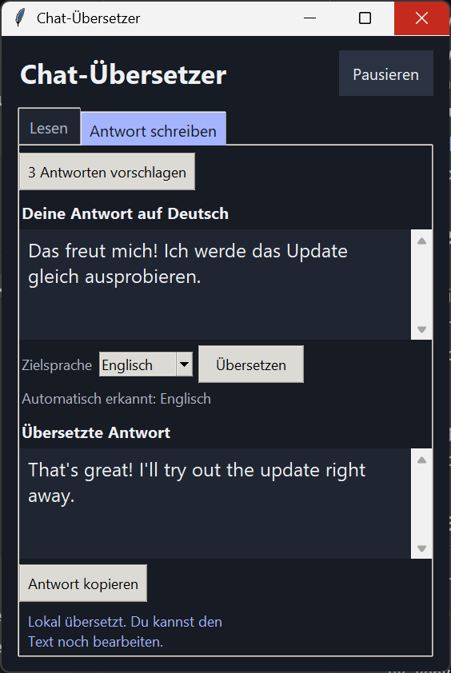
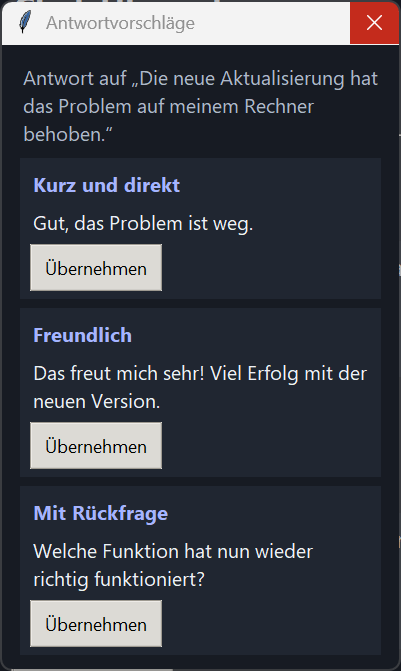

# Chat-Übersetzer für Windows

[**Windows-EXE herunterladen**](https://github.com/Doom666DE/chat-uebersetzer/releases/latest/download/Chat-Uebersetzer-win-x64.exe) · [**Einrichtung auf Deutsch**](Ollama-Anleitung.md) · [**English setup guide**](README.en.md) · [Aktueller Release](https://github.com/Doom666DE/chat-uebersetzer/releases/latest)

Übersetze ausgewählte Nachrichten aus Discord Desktop und WhatsApp Desktop. Für eingehende Übersetzungen, Antwortvorschläge und fertige Antworten kannst du unabhängig voneinander Deutsch, Englisch, Polnisch oder Türkisch wählen. Ollama läuft auf deinem PC.

## So sieht die App aus

| Nachrichten lesen | Antworten übersetzen | Antworten vorschlagen |
| --- | --- | --- |
|  |  |  |

Die Screenshots zeigen Beispielnachrichten.

## Download und Einrichtung

1. Lade die [Windows-EXE](https://github.com/Doom666DE/chat-uebersetzer/releases/latest/download/Chat-Uebersetzer-win-x64.exe) herunter und speichere sie in einem Ordner deiner Wahl.
2. Installiere [Ollama für Windows](https://ollama.com/download/windows) und lade das Modell nach der [Schritt-für-Schritt-Anleitung](Ollama-Anleitung.md).
3. Starte **Chat-Uebersetzer-win-x64.exe**, sobald Ollama läuft und das Modell heruntergeladen ist.

Die App ist für **Windows x64** gebaut. Discord und WhatsApp wurden unter Windows 11 getestet. Die EXE bringt Python mit und nutzt die [Microsoft Visual C++ Laufzeit für x64](https://learn.microsoft.com/cpp/windows/latest-supported-vc-redist). Wenn sie auf deinem PC noch fehlt, installiere sie über Microsoft.

Die EXE ist unsigniert. Windows SmartScreen kann den Download oder den Start als unbekannte App kennzeichnen. Die Release-Datei `SHA256SUMS.txt` enthält die Prüfsumme der EXE zur Kontrolle des Downloads. [Microsoft zu SmartScreen](https://learn.microsoft.com/windows/apps/package-and-deploy/smartscreen-reputation)

## Bedienung

- **Oberfläche.** Wähle oben **Deutsch** oder **English**. Die App merkt sich die Auswahl für den nächsten Start.
- **Lesen.** Wähle die **Lesesprache** und markiere Text in Discord oder WhatsApp. Ein Doppelklick versucht, die ganze Nachricht zu erfassen.
- **Antwort schreiben.** Tippe deinen Entwurf. Wenn die App die markierte Nachricht als Deutsch, Englisch, Polnisch oder Türkisch erkennt, wählt sie diese **Zielsprache** für die fertige Antwort. Du kannst sie manuell ändern.
- **Antwortvorschläge.** Wähle die **Vorschlagssprache** und klicke auf **3 Antworten vorschlagen**, sobald die markierte Nachricht übersetzt ist. Mit **Übernehmen** setzt du einen Vorschlag in den Entwurf.
- **Abschicken.** Klicke auf **Übersetzen**, prüfe die Fassung und wähle **Antwort kopieren**. Füge sie mit **Strg + V** in Discord oder WhatsApp ein und sende sie dort selbst.

Mit **Wie Oberfläche** übernehmen Lese- und Vorschlagssprache automatisch die Oberflächensprache. Feste Einstellungen bleiben beim Wechsel der Oberfläche und nach dem Neustart erhalten.

## Updates

Ab v0.5.0 prüft die App beim Start und danach alle sechs Stunden auf neue stabile GitHub-Releases. Über **Updates prüfen** kannst du die Prüfung jederzeit starten. Wenn ein Update verfügbar ist, lädt **Installieren** die neue Windows-EXE herunter, vergleicht ihre SHA-256-Prüfsumme mit den Angaben von GitHub und startet die App neu. Für die Installation muss der Ordner mit der EXE beschreibbar sein.

Beim Schreiben einer Antwort fragt die App vor dem Neustart nach. Sprach­einstellungen bleiben erhalten. Die Update-Prüfung und der Download verbinden sich mit GitHub und übertragen keine Chattexte oder Entwürfe.

Ab v0.5.4 zeigt **Änderungen** bei einem verfügbaren Update die GitHub-Release-Notizen direkt in der App. Ab v0.5.6 öffnet **GitHub-Release öffnen** in dieser Vorschau die vollständige Release-Seite im Standardbrowser.

## Lokale Verarbeitung

Die App liest mit Windows UI Automation den Text deiner Auswahl aus dem geöffneten Fenster. Die einzige Verbindung für Übersetzung, Spracherkennung und Antwortvorschläge geht an Ollama auf `127.0.0.1:11434`. Die App benötigt dafür weder Discord- noch WhatsApp-Zugangsdaten. Sie speichert die Texte im Arbeitsspeicher. **Antwort kopieren** schreibt deinen fertigen Text in die Windows-Zwischenablage.

Änderungen an der Oberfläche von Discord oder WhatsApp können die Erfassung beeinflussen. Übersetzungen und Antwortvorschläge können sprachliche oder inhaltliche Fehler enthalten.

## Aus dem Quellcode starten oder bauen

Die folgenden Befehle sind für PowerShell auf Windows x64 gedacht. Installiere zuerst [uv](https://docs.astral.sh/uv/getting-started/installation/), öffne eine neue PowerShell und wechsle in den Ordner mit dieser README.

```powershell
uv venv --managed-python --python 3.14.7
uv pip sync --python .venv\Scripts\python.exe requirements-build.txt
.\.venv\Scripts\python.exe chat_uebersetzer.py
```

Zum Erstellen der Windows-Datei verwende dieselbe Umgebung.

```powershell
.\.venv\Scripts\python.exe -m PyInstaller --noconfirm chat-uebersetzer.spec
```

Die Startdatei liegt danach unter `dist/Chat-Uebersetzer-win-x64.exe`. Der Build erzeugt die Windows-Bedienungshilfe-Schnittstelle auf dem jeweiligen Rechner und enthält die Lizenztexte der mitgelieferten Komponenten.

## Lizenz

Der Projektcode steht unter der [MIT-Lizenz](LICENSE). Die Lizenztexte der mitgelieferten Komponenten stehen unter [third-party](third-party/README.md). Ollama und das [Qwen3-Modell](https://ollama.com/library/qwen3:4b-instruct) werden separat bezogen. Dies ist ein unabhängiges Projekt.
